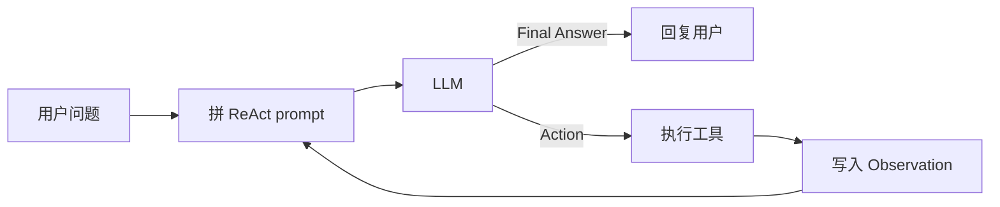
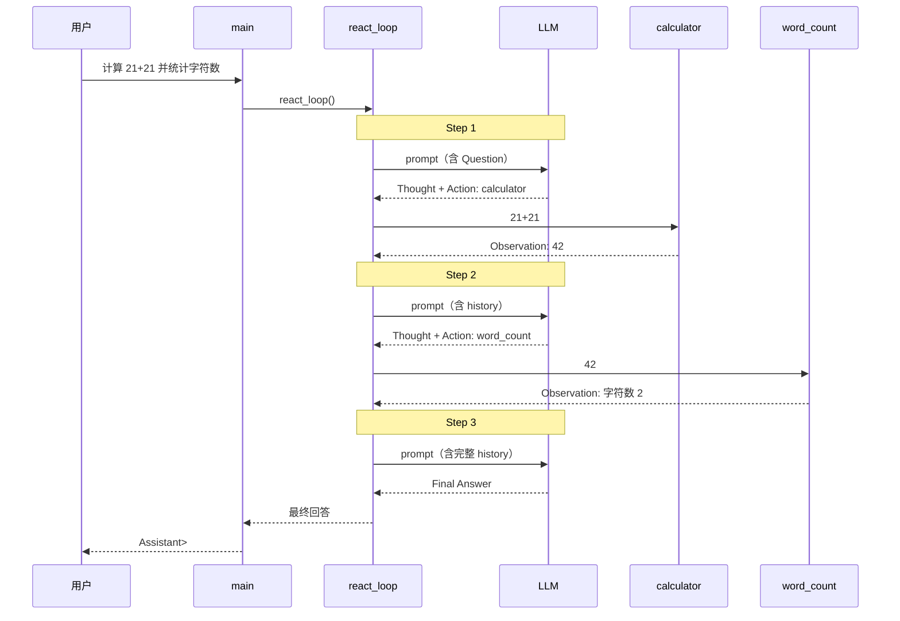

# ReAct Agent 示例

简化版 ReAct（Reasoning + Acting）循环：LLM 按 **Thought → Action → Observation** 格式推理，必要时调用工具，最后给出 **Final Answer**。

## 目录结构

```
01-Agent_react/
├── src/
│   ├── main.ts      # 入口
│   ├── loop.ts      # ReAct 主循环
│   ├── prompt.ts    # 提示词构建 / Action 解析
│   ├── llm.ts       # OpenRouter 调用 + JSON 日志
│   ├── tools.ts     # 工具实现与注册（含安全计算器）
│   └── types.ts     # Tool / LLM / HistoryItem 类型
├── package.json
├── tsconfig.json
├── .env.example
└── Readme.md
```

## 模块说明

| 模块 | 职责 |
|------|------|
| `src/main.ts` | 组装工具与 LLM，启动 ReAct 循环 |
| `src/loop.ts` | ReAct 主循环：拼 prompt → 调 LLM → 执行工具 → 写入 history |
| `src/prompt.ts` | 构建 ReAct prompt，解析 `Action` / `Action Input` |
| `src/llm.ts` | 加载 `.env`，调用 OpenRouter API；自动打印请求/响应 JSON |
| `src/tools.ts` | 三个内置工具；计算器用递归下降解析，不使用 `eval` |

## 内置工具

| 工具 | 作用 |
|------|------|
| `calculator` | 安全计算数学表达式（`+ - * / // % **` 和括号） |
| `get_current_time` | 获取指定时区当前时间，默认 `Asia/Shanghai` |
| `word_count` | 统计文本字符数和词数 |

## 快速开始

需要 Node.js 24+（直接运行 `.ts`，无需构建）。

### 1. 安装依赖

```bash
cd 01-Agent_react
npm install
```

### 2. 配置 API Key

```bash
cp .env.example .env
```

编辑 `.env`，填入 OpenRouter API Key：

```
OPENROUTER_API_KEY=your_api_key_here
```

### 3. 运行

```bash
npm start
```

类型检查：

```bash
npm run check
```

## 流程图

### 横版概览



### 时序图

以默认问题为例（2 次工具调用，3 轮 LLM）：



| 步骤 | 日志标记 | 说明 |
|------|----------|------|
| ① | `Step 1` + `LLM request/response` | LLM 决定调用 calculator |
| ② | `Tool execution` | 本地计算 `21+21 = 42` |
| ③ | `Step 2` + `LLM request/response` | LLM 决定调用 word_count |
| ④ | `Tool execution` | 统计 `"42"` 字符数 |
| ⑤ | `Step 3` + `LLM response` | 输出 Final Answer |

## ReAct 单轮格式

```
Thought: 我需要先计算 ...
Action: calculator
Action Input: 21+21
        ↓ 工具执行
Observation: 42
        ↓ 下一轮
Thought: 已有结果
Final Answer: 42
```

## 扩展

### 新增工具

1. 在 `src/tools.ts` 的 `buildDefaultTools()` 数组里加一项 `{ name, description, run }`，`run` 签名为 `(input: string) => string`。
2. `src/prompt.ts` 会自动从 tools 读取工具描述，无需额外修改。

### 新增 LLM

实现 `LLM` 类型（`(prompt: string) => Promise<string>`），传给 `reactLoop` 即可，参考 `src/llm.ts`。
